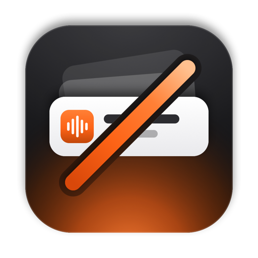
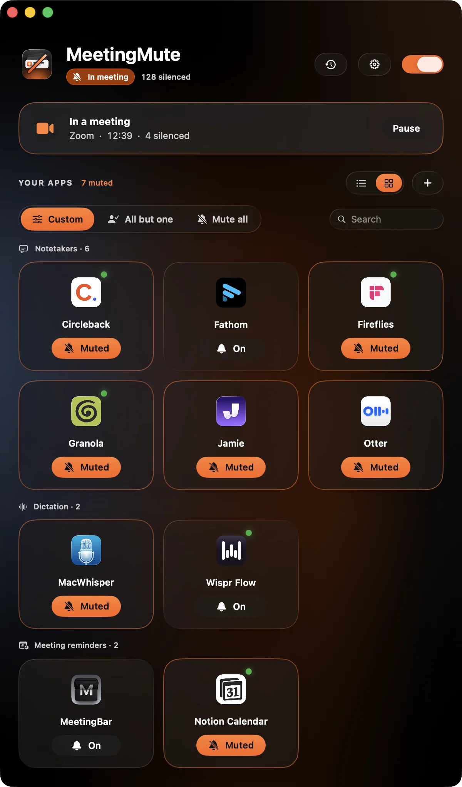
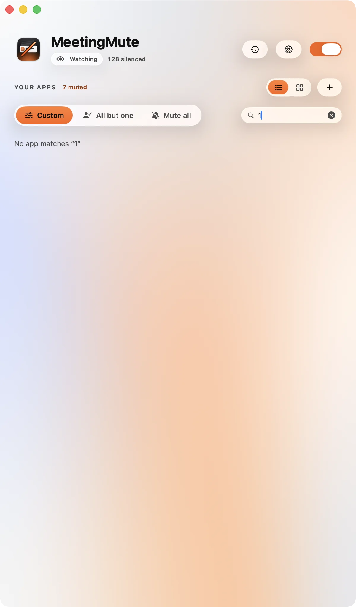
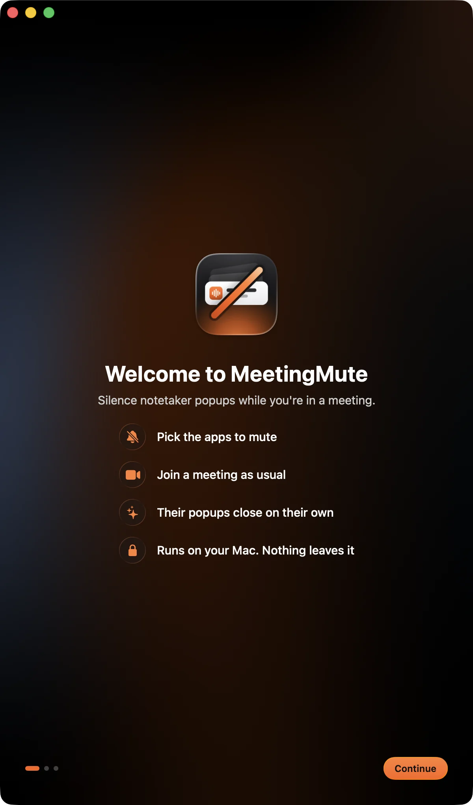
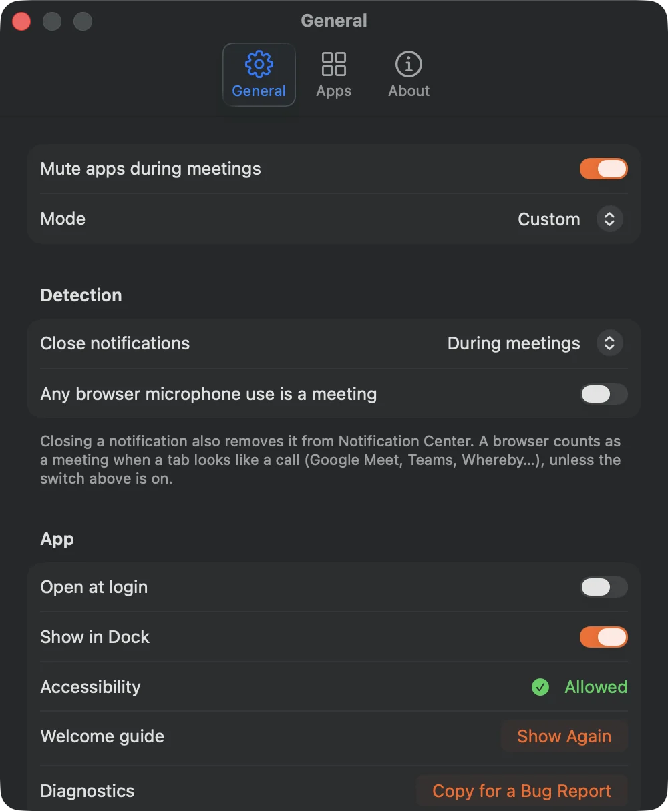
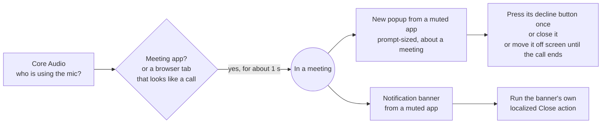

<p align="center">
  
</p>

<h1 align="center">MeetingMute</h1>

<p align="center">
  <b>Silence AI notetaker popups the moment a call starts.</b><br>
  A tiny, private macOS menu bar app for people with more than one notetaker fighting for attention.
</p>

<p align="center">
  <a href="https://github.com/meetstream-ai/MeetingMute/actions/workflows/ci.yml"></a>
  
  
  <a href="docs/SUPPORTED_APPS.md"></a>
  <a href="LICENSE"></a>
  <a href="https://meetstream.ai"></a>
</p>

<p align="center">
  <a href="#install">Install</a> ·
  <a href="#how-it-works">How it works</a> ·
  <a href="docs/SUPPORTED_APPS.md">Supported apps</a> ·
  <a href="#faq">FAQ</a> ·
  <a href="CONTRIBUTING.md">Contributing</a>
</p>

<p align="center">
  
</p>

## Why

You join a call. Granola says **Meeting detected**. Wispr Flow starts a **10 second countdown**. Fireflies asks to **invite its bot**. MacWhisper wants to **record**. Your calendar reminds you about the *next* meeting. All at once, on top of the person you're talking to.

AI notetakers are great, and plenty of people run two or three. MeetingMute lets you keep them installed and pick which ones are allowed to speak up. The rest are quietly declined as soon as they appear.

## Features

- **Per-app mute.** Tap the bell on any app. Or use **All but one** (only your favourite may prompt) or **Mute all**.
- **Knows 86 apps out of the box.** Notetakers, dictation apps, recorders and meeting reminders, each matched by an evidence-backed bundle ID ([full list](docs/SUPPORTED_APPS.md)). Add any other app with **+**, and apps that start using the microphone are suggested.
- **Detects meetings by itself.** Zoom, Teams, Slack huddles, Webex, FaceTime, Discord, WhatsApp and more, plus Google Meet, Teams and Whereby in any browser.
- **Declines safely.** It presses a prompt's own *Not now / Dismiss / Don't Record* button, never one that records, joins, invites a bot or changes the other app's settings.
- **Closes notification banners too,** in any system language, during meetings or always.
- **Pause for this meeting** when you actually want a notetaker to ask.
- **Tells you how to stop it at the source,** with the exact setting in each app that turns its prompt off.
- **Private by design.** No network access, no analytics, no recording. It only needs Accessibility.
- **Native.** SwiftUI and AppKit, Liquid Glass on macOS 26, light and dark mode. Popup and banner handling runs off the main thread with a short timeout, so a hung app never freezes it.

## Supported apps

<!-- supported-apps:start -->

**Notetakers:** Altar AI, Alter, Amie, Anarlog, Attention, Avoma, Bluedot, Capy, Circleback, Claap, Clari Copilot, Cluely, Detto, Fathom, Fellow, Fireflies, Fyxer, Grain, Granola, Hedy, Heizen Meets, Jamie, Jiminny, Junior, Krisp, Laxis, Littlebird, MeetGeek, Meetily, Meeting Intelligence, MeetingRecorder, Meetly, MeetMic, MeetNotes AI, Minute, MinuteForge, Narada, NoteAI, Noted, Notion, Notta, Omi, Otter, Plaud, Quill, Read AI, RiverScript, ScreenApp, Shadow, Supernormal, Sybill, Tablo, tl;dv.

**Dictation and transcription:** Amical, GhostPepper, MacParakeet, MacWhisper, Monologue, Muesli, OpenWhispr, Vibe, Wispr Flow.

**Recorders:** Zight.

**Meeting reminders:** Akiflow, BigReminder, Calerto, Dato, Dot, Fantastical, JustJoin, Meeting Hero, Meeting Reminder In Your Face, MeetingBar, MinMaxCal, Morgen, Next - Meeting Alerts, Next Meeting, Notion Calendar, Quick Join, Remind, Slapss, Soonie.

**AI assistants:** ChatGPT.

See [all 86 apps, their bundle IDs and where to turn each prompt off](docs/SUPPORTED_APPS.md).

<!-- supported-apps:end -->

Missing one? [Request it](https://github.com/meetstream-ai/MeetingMute/issues/new?template=new-app.yml), or add it yourself in two minutes ([how](CONTRIBUTING.md#add-an-app)).

## Install

**Requirements:** macOS 14 Sonoma or later, and the Xcode Command Line Tools (`xcode-select --install`). The full Xcode app is not needed.

```sh
git clone https://github.com/meetstream-ai/MeetingMute.git
cd MeetingMute
./setup-signing.sh      # one time: a local code-signing identity, so permissions survive rebuilds
./build.sh --run        # builds build/MeetingMute.app and opens it
```

Then move it into Applications if you like:

```sh
cp -R build/MeetingMute.app /Applications/
open /Applications/MeetingMute.app
```

`build.sh` options: `--run` (relaunch after building), `--universal` (Apple silicon and Intel), `--zip` (also write `build/MeetingMute.zip`).

<details>
<summary><b>Why <code>setup-signing.sh</code>?</b></summary>

macOS remembers privacy permissions per code signature. Without a stable signature every rebuild looks like a new app, and you'd have to allow Accessibility again. The script creates a self-signed certificate called **MeetingMute Dev** in your login keychain, and `build.sh` signs with it.

- Keychain Access shows the certificate as "not trusted". That's expected and harmless.
- If macOS asks whether `codesign` may use the key, choose **Always Allow**.
- Skip the script and `build.sh` falls back to ad-hoc signing. That works, but you'll re-allow Accessibility after each build.
</details>

### First launch

A short guide walks you through it:

1. **Welcome**: what MeetingMute does.
2. **Accessibility**: switch on **MeetingMute** in *System Settings › Privacy & Security › Accessibility*. It's the only permission MeetingMute uses: it lets it press a popup's decline button and close notification banners.
3. **Choose apps**: tap the bell on any app to mute it. Change it any time.

To start at login, turn on **Settings › General › Open at login**.

## Using it

| Where | What you can do |
| --- | --- |
| **Main window** | Mute or allow each app, switch mode (Custom, All but one, Mute all), rows or tiles, search, turn MeetingMute off. During a call: where it was detected, how many prompts were silenced, and **Pause**. |
| **Menu bar** | Live status icon, the same switches, and **Pause for this meeting**. Works with the Dock icon hidden. |
| **Clock button** | Activity by day: meetings, popups closed, notifications closed. |
| **Right-click an app** | Open it, see the setting that turns its prompt off at the source, open its Notification settings, *Only Allow This App*, *Mute All*, *Unmute All*, remove it. |
| **Settings** (⌘,) | Close notifications during meetings or always, count any browser microphone use as a meeting, open at login, show in Dock, add or restore apps, copy diagnostics for a bug report. |

<table>
  <tr>
    <td></td>
    <td></td>
    <td></td>
  </tr>
  <tr>
    <td align="center">List view, light mode</td>
    <td align="center">Welcome guide</td>
    <td align="center">Settings</td>
  </tr>
</table>

## How it works



1. **Meeting detection.** Core Audio lists which processes are recording. That needs no microphone permission and records nothing. A meeting app on the microphone (or Zoom's meeting helper) means a call. A browser on the microphone only counts when one of its windows is a call (Google Meet, Teams on the web, Whereby, Jitsi…), so voice search and dictation sites don't. The meeting ends 30 seconds after the signal stops, which rides out a muted stretch.
2. **Popups.** During a call, a window from a muted app is a candidate only if it is **new** (appeared just before the call or during it), **prompt-sized**, and its text is **about a meeting**. MeetingMute then presses that app's decline button once. The button list comes from research on each app; anything that records, joins, invites a bot or changes settings is never pressed. If there's no safe button, and the window clearly reads as that app's call-start prompt, it uses the window's own close button, and failing that moves the popup off screen and puts it back when the call ends, when you pause or unmute, or when MeetingMute quits. Anything less certain is left alone.
3. **Notification banners.** Banners from muted apps are closed with Notification Center's own *Close* action, matched in every language macOS ships. On macOS 26 all banners share one host window, which MeetingMute never hides.

**Safety rules**

- Meeting apps and browsers are never touched, and neither is any app you allow.
- Your own windows are left alone: the focused window, main windows, and windows that were already open before the call, before you resumed, or before you muted the app (unless one changes into a prompt).
- Each popup gets one press. No loops, no fighting the other app.
- Nothing is written outside MeetingMute's own preferences.

### Stop it at the source

Hiding a prompt is not the same as declining it. Some apps start recording after a countdown unless you decline (Wispr Flow, Supernormal, Circleback), which is why MeetingMute presses their decline button rather than hiding them. Every app on the list also has its own switch, and MeetingMute shows it under each app and in the right-click menu. For example: *Granola › Settings › Notifications*, *Wispr Flow › Settings › Notetaker › Automatically detect any call*, *Otter › Desktop App Settings › Meeting Detection*.

## Privacy

MeetingMute runs entirely on your Mac. It has no network code, no analytics and no crash reporting. It never records audio: it only reads Core Audio's "is this process recording?" flag. It reads the text of popups from muted apps to decide whether they are meeting prompts, and keeps nothing but a local activity log ("Closed Granola popup"). Settings live in `~/Library/Preferences/ai.meetstream.MeetingMute.plist`.

## FAQ

<details>
<summary><b>"Needs Accessibility" won't go away</b></summary>

Open *System Settings › Privacy & Security › Accessibility*, remove MeetingMute with the minus button, add it again and switch it on. If you rebuilt without `setup-signing.sh`, reset the stale entry first:

```sh
tccutil reset Accessibility ai.meetstream.MeetingMute
```
</details>

<details>
<summary><b>A muted app's popup still appears</b></summary>

- Check that the app shows **Muted** and MeetingMute is on.
- Open the activity log (clock button). If it never says "Meeting started", your meeting app isn't recognised: open an issue with its name.
- If it says "Meeting started" but nothing was closed, please [open an issue](https://github.com/meetstream-ai/MeetingMute/issues/new?template=bug-report.yml) and paste **Settings › General › Copy for a Bug Report**. A screenshot of the popup helps a lot.
</details>

<details>
<summary><b>Does it work with Google Meet in the browser?</b></summary>

Yes. A browser counts as a meeting when it's using the microphone and one of its windows looks like a call. If your call service isn't recognised, turn on **Settings › Any browser microphone use is a meeting**.
</details>

<details>
<summary><b>Will it close notifications I want to see?</b></summary>

Only from apps you muted, and by default only during meetings. Closing a banner also removes it from Notification Center, so if you want a muted app's notifications later, set **Close notifications** to *During meetings* (the default) and keep that app's own notifications on.
</details>

<details>
<summary><b>I upgraded from 1.0 and my Accessibility permission is gone</b></summary>

1.1 has a new bundle ID (`ai.meetstream.MeetingMute`), so macOS sees a new app. Your settings carry over automatically; allow Accessibility once more, and remove the old entry with `tccutil reset Accessibility com.rohanganesh.MeetingMute`.
</details>

## Uninstall

```sh
rm -rf /Applications/MeetingMute.app                      # or build/MeetingMute.app
defaults delete ai.meetstream.MeetingMute                 # preferences
tccutil reset Accessibility ai.meetstream.MeetingMute     # permission entry
security delete-identity -c "MeetingMute Dev"             # signing certificate (optional)
```

## Development

```
registry/apps.json           the built-in app list, with evidence for every bundle ID
scripts/gen_registry.py      turns it into Swift, docs/SUPPORTED_APPS.md and the README list
scripts/make-icon.swift      draws the app icon (Core Graphics, no dependencies)
Sources/MeetingMuteCore/     pure logic: registry, matching, dismiss policy, meeting detection
Sources/MeetingMute/
  Model/                     Core Audio input, the Accessibility engine, the app list, settings
  Views/                     main window, menu bar, settings, onboarding
  Theme/                     colours, glass, animated background
Sources/CoreChecks/          `swift run CoreChecks`: checks that run with only the Command Line Tools
```

- `swift run CoreChecks` checks the matching rules, every bundle-ID trap the research found, and the dismiss policy.
- `open build/MeetingMute.app --args --demo` opens a screenshot mode with sample apps and no Accessibility work. Add `--demo-meeting`, `--demo-rows`, `--demo-onboarding`, `--demo-settings`, `--light`, `--dark` or `--demo-icons <folder>`.
- Changed `registry/apps.json`? Run `python3 scripts/gen_registry.py`. CI fails if the generated files are stale, and runs `CoreChecks` on Linux.

See [CONTRIBUTING.md](CONTRIBUTING.md) for how to add an app or report a popup that slips through.

## Credits

Built by **[Rohan Ganesh](https://github.com/RohannGanesh)** and **[Sidhdharth Sivasubramanian](https://github.com/doluz)** at **[MeetStream](https://meetstream.ai)**.

MeetStream builds meeting bot infrastructure: an API to join, record, transcribe and stream Zoom, Google Meet and Microsoft Teams calls. If you build a notetaker yourself, [take a look](https://meetstream.ai).

App names and icons belong to their owners and are used only to identify the apps MeetingMute works with. MeetingMute is not affiliated with or endorsed by any of them.

## License

[MIT](LICENSE)
