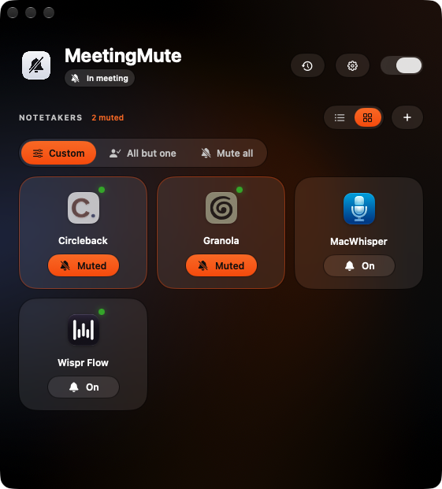
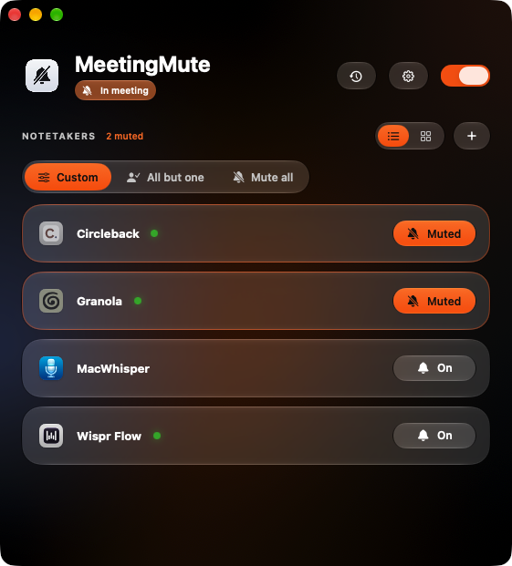
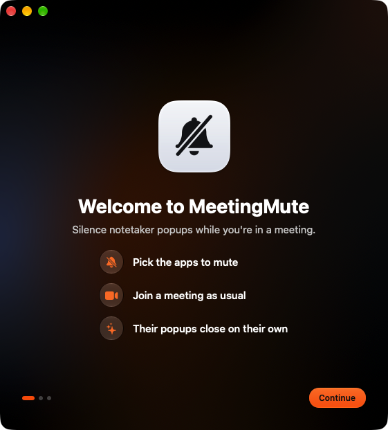
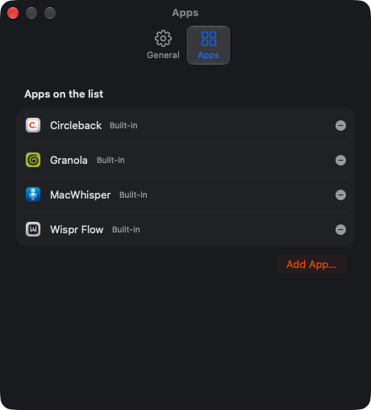

<p align="center">
  
</p>

<h1 align="center">MeetingMute</h1>

<p align="center">
  Silence notetaker popups and notifications on macOS.<br>
  For people with more than one AI notetaker fighting for attention when a call starts.
</p>

<p align="center">
  
  
</p>

## Why

Granola, Circleback, Wispr Flow, MacWhisper, Otter and friends all want to say *"Meeting detected!"* the moment you join a call. Pick the ones you don't want to hear from, and MeetingMute closes their popups and notifications for you.

## Features

- **Per-app mute**: tap the bell on any notetaker
- **Three modes**: *Custom* (pick each app), *All but one* (only one app may prompt), or *Mute all*
- **Auto-detects notetakers**: finds known apps when it starts, rechecks every time an app launches, and adds any non-meeting app that starts using the microphone
- **Knows when you're in a meeting**: Zoom, Teams, Slack, Webex, FaceTime, Discord, WhatsApp, or Google Meet in a browser
- **Rows or tiles** layout, quick toggles in the menu bar
- **Settings window** to add any app by hand, remove apps, or bring removed ones back
- **Private**: runs entirely on your Mac, with no network access, no analytics, and no changes to other apps' settings

## Requirements

- macOS 14 Sonoma or later (Liquid Glass styling on macOS 26)
- Xcode Command Line Tools for building, which you can install with:
  ```sh
  xcode-select --install
  ```
  The full Xcode app is not needed.

## Install

```sh
git clone https://github.com/RohannGanesh/MeetingMute.git
cd MeetingMute
./setup-signing.sh      # one time: creates a local code-signing identity
./build.sh --run        # builds build/MeetingMute.app and opens it
```

You can move the app into Applications if you like:

```sh
cp -R build/MeetingMute.app /Applications/
open /Applications/MeetingMute.app
```

### Why `setup-signing.sh`?

macOS remembers privacy permissions per code signature. Without a stable signature, every rebuild looks like a brand new app and you'd have to grant Accessibility again. The script creates a self-signed certificate called **MeetingMute Dev** in your login keychain, and `build.sh` signs with it automatically.

- Keychain Access shows the certificate as "not trusted". That's expected and doesn't affect anything.
- If macOS asks whether `codesign` may use the key, choose **Always Allow**.
- If you skip the script, `build.sh` falls back to ad-hoc signing. That works, but you'll need to re-grant Accessibility after each build.

## First launch

A short guide walks you through setup:

1. **Welcome**: what MeetingMute does.
2. **Accessibility**: click **Open System Settings**, then switch on **MeetingMute** under *Privacy & Security → Accessibility*. This is the only permission MeetingMute needs. It's used to close other apps' popups and notification banners.
3. **Choose apps**: tap any notetaker to mute it. You can change this any time.

<p align="center">
  
</p>

To see the guide again, go to **Settings → General → Welcome guide → Show Again**.

## Using MeetingMute

| Where | What you can do |
| --- | --- |
| **Main window** | Tap a bell to mute or unmute an app. Switch the mode, switch between rows and tiles, or turn MeetingMute off with the switch at the top. |
| **Clock button** | Activity log: meetings detected and popups closed. |
| **Menu bar icon** (🔕) | Status and quick mute toggles without opening the window. |
| **Settings** (⌘, or the gear) | Add any app, remove apps, restore removed ones, and check the permission status. |
| **Right-click an app** | Open it, open its Notification settings, *Only Allow This App*, *Mute All*, *Unmute All*, or remove it. |

<p align="center">
  
</p>

### Modes

- **Custom**: every app is muted or allowed on its own.
- **All but one**: one app may prompt and the rest are muted. Unmuting a different app makes it the one allowed.
- **Mute all**: every app is muted, including ones detected later.

### Adding an app that isn't listed

Open **Settings → Apps → Add App…** (or click **+** in the main window) and pick the app. Apps that start using the microphone outside a call are added automatically.

### Start at login

Go to **System Settings → General → Login Items** and add MeetingMute under *Open at Login*.

## How it works

1. **Meeting detection.** A meeting is "on" while a meeting app (Zoom, Teams, a browser, and so on) is using the microphone. This is read from Core Audio's process list, which needs no microphone permission and records nothing. A meeting ends after about 5 seconds of silence.
2. **Notification banners.** Banners posted by muted apps are dismissed through Accessibility whenever MeetingMute is on, because notetakers also notify before and after calls.
3. **Popup windows.** During a meeting, small popup windows from muted apps are dismissed by pressing their own *Dismiss / Not now / Close* button. If a popup has no such button, it's moved off-screen for the rest of the meeting and put back afterwards.

Safety rules:
- Meeting apps are never touched.
- Allowed apps are never touched.
- Large regular windows are left alone.
- Nothing is written outside MeetingMute's own preferences.

## Troubleshooting

**"Needs Accessibility" won't go away**
Open *System Settings → Privacy & Security → Accessibility*. Remove MeetingMute with the **–** button, add it again, and switch it on. If you rebuilt without `setup-signing.sh`, reset the stale entry first:
```sh
tccutil reset Accessibility com.rohanganesh.MeetingMute
```

**A muted app's popup still appears**
- Make sure the app shows **Muted** and the switch at the top of the window is on.
- Check the activity log (clock button). If it never says "Meeting started", your meeting app may not be recognised. Please open an issue and say which app you use.
- If it says "Meeting started" but nothing was closed, please open an issue with a screenshot of the popup.

**An app I removed doesn't come back**
Removed apps are never auto-detected again. Restore them from **Settings → Apps → Removed**.

## Uninstall

```sh
rm -rf /Applications/MeetingMute.app                      # or build/MeetingMute.app
defaults delete com.rohanganesh.MeetingMute               # preferences
tccutil reset Accessibility com.rohanganesh.MeetingMute   # permission entry
security delete-identity -c "MeetingMute Dev"             # signing certificate (optional)
```

## Project layout

```
Sources/MeetingMute/
  MeetingMuteApp.swift        app entry, windows, menu bar
  Model/
    AppCatalog.swift          installed and running apps
    MeetingApps.swift         apps that count as "in a meeting"
    MeetingPrompts.swift      known notetakers, mute state, modes, activity log
    PromptSuppressor.swift    meeting detection, closing banners and popups
  Views/                      HomeView, OnboardingView, SettingsView, MenuBarView
  Theme/                      colors, glass, animated background
Resources/                    Info.plist, AppIcon.icns
scripts/make-icon.py          rebuilds the icon (needs Pillow: pip3 install pillow)
build.sh, setup-signing.sh
```

## Contributing

Issues and pull requests are welcome, especially:
- bundle IDs for notetakers that are only matched by name today (see `KnownRecorder.all` in `MeetingPrompts.swift`)
- popups that slip through
